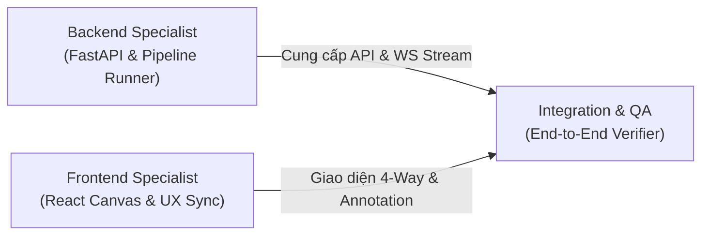

# AGENTS GUIDELINES & PROTOCOL – MYPIXEL (ARTDIFF)
> **Mục tiêu:** Hướng dẫn, chuẩn mực hành vi và phân vai cho các Coding Agent (AI) tham gia phát triển dự án.  
> **Nguyên tắc cốt lõi:** Làm việc theo từng Task độc lập, kiểm thử chặt chẽ trước khi chuyển bước, bảo toàn tuyệt đối logic cốt lõi đã nghiệm thu của Phase 1.

---

## 1. Bối cảnh & Sứ mệnh của Coding Agent

Dự án **MyPixel (ARTDIFF)** là công cụ kiểm định bao bì in ấn chính xác cao giữa bản thiết kế gốc (Brand) và bản dàn trang in ấn (Vendor/Supplier). 
Sứ mệnh của Agent là hiện thực hóa kiến trúc mới tại [`new_architecture.md`](file:///Users/tindn/Downloads/MyPixel-v1/new_architecture.md):
- Dựng **Backend FastAPI** bọc toàn bộ pipeline Phase 1, stream log theo thời gian thực qua WebSocket.
- Dựng **Frontend React + Vite** với trạm làm việc kiểm định 4 khung hình đồng bộ tuyệt đối (4-Way Synced Viewport), kính lúp (Loupe), vẽ box đồng bộ đa khung và xuất báo cáo lỗi.

---

## 2. Các Nguyên tắc Bất di bất dịch (Inviolable Rules)

Mọi Agent khi thực thi code trên repository này **BẮT BUỘC TUÂN THỦ** các nguyên tắc sau:

### ⚠️ R0. BẮT BUỘC ĐỌC `progress.md` & `new_architecture.md` ĐẦU TIÊN
- Khi bắt đầu bất kỳ phiên làm việc nào hoặc nhận bất kỳ yêu cầu mới nào, Agent **BẮT BUỘC PHẢI ĐỌC 2 FILE NÀY TRƯỚC TIÊN**:
  1. [`progress.md`](file:///Users/tindn/Downloads/MyPixel-v1/progress.md): Để biết chính xác các Milestone nào đã hoàn thành, kết quả test hiện tại ra sao, và Milestone nào là việc tiếp theo cần làm theo roadmap.
  2. [`new_architecture.md`](file:///Users/tindn/Downloads/MyPixel-v1/new_architecture.md): Để nắm vững kiến trúc kỹ thuật, cấu trúc thư mục, state store và các hợp đồng đồng bộ dữ liệu.
- **Nghiêm cấm:** Không tự ý suy đoán trạng thái dự án, không làm nhảy cóc Milestone, không viết code khi chưa nắm rõ ngữ cảnh từ 2 file trên.
- Sau khi hoàn thành bất kỳ Task/Milestone nào, Agent **BẮT BUỘC PHẢI CẬP NHẬT `progress.md`** để lưu vết tiến độ cho phiên tiếp theo.

### ⚠️ R1. BẢO VỆ TUYỆT ĐỐI PHASE 1
- **Không tự ý sửa đổi** các file trong thư mục [`artdiff/`](file:///Users/tindn/Downloads/MyPixel-v1/artdiff/) trừ khi cần bổ sung hook truyền log hoặc tham số xuất ảnh đã được quy định rõ trong spec.
- 24/24 unit & integration tests của Phase 1 đang đạt 100% pass trên 2 bộ file thật. Bất kỳ thay đổi nào làm gãy tests Phase 1 đều bị coi là lỗi nghiêm trọng.

### ⚠️ R2. TOÀN BỘ CHẠY LOCAL, ZERO-CLOUD, ZERO-GPU
- Không tích hợp bất kỳ dịch vụ cloud bên ngoài nào (OpenAI, Google Cloud, AWS...). File bao bì của khách hàng là dữ liệu bảo mật thương mại tuyệt đối.
- Toàn bộ backend chạy trên CPU cục bộ (FastAPI, OpenCV, PyMuPDF). Frontend chạy trên trình duyệt local (`http://localhost:...`).

### ⚠️ R3. ĐƠN VỊ CHUẨN LÀ `mm`
- Mọi kích thước khung, toạ độ Bounding Box, báo cáo xuất ra đều dùng đơn vị vật lý là **milimet (mm)** hoặc **tỉ lệ chuẩn hoá $[0, 1]$**.
- Pixel chỉ là chi tiết nội bộ khi hiển thị trên màn hình. Mọi phép quy đổi giữa mm và px phải sử dụng hàm chuẩn trong [`artdiff/core/units.py`](file:///Users/tindn/Downloads/MyPixel-v1/artdiff/core/units.py).

### ⚠️ R4. Ý THỨC HIỆU NĂNG ẢNH ĐỘ PHÂN GIẢI CAO (20–30 MEGAPIXEL)
- Ảnh in bao bì ở 300 DPI có kích thước rất lớn (khoảng `7322 × 2953 px` ~ 21 MP trở lên).
- **Tuyệt đối không:** Nhồi nhét ảnh full-res trực tiếp vào DOM mà không dùng GPU acceleration; không re-render toàn bộ thẻ `` mỗi lần chuột di chuyển.
- **Bắt buộc:** Áp dụng CSS Hardware-Accelerated transform (`translate3d` và `scale`) hoặc HTML5 Canvas/WebGL để đảm bảo thao tác Pan/Zoom trên cả 4 khung hình đồng bộ luôn duy trì **mượt mà 60 FPS**.

### ⚠️ R5. PHÁT TRIỂN CUỐN CHIẾU – TEST XONG MỚI SANG BƯỚC MỚI
- Không generate toàn bộ dự án hay nhiều module cùng một lúc.
- Làm từng Task nhỏ $\to$ viết test/kiểm tra thực tế $\to$ xác nhận chạy ngon $\to$ mới chuyển sang Task tiếp theo theo đúng Milestone trong [`new_architecture.md`](file:///Users/tindn/Downloads/MyPixel-v1/new_architecture.md).

---

## 3. Phân vai & Trách nhiệm (Agent Roles)

Khi triển khai các phần của dự án, Agent cần tự định vị theo vai trò chuyên trách:

### 3.1. Role: Backend Specialist (`server/`)
* **Phạm vi quản lý:** Thư mục `server/`, các endpoint REST, WebSocket runner, schema Pydantic, xuất báo cáo.
* **Nhiệm vụ:**
  1. Viết `server/runner.py`: Thực thi `pipeline_phase1.run_phase1` trong thread an toàn, không block server.
  2. Bắt các sự kiện log từng Task của Phase 1 (Task 1 $\to$ Task 6) và phát trực tiếp (broadcast) qua WebSocket dạng JSON có cấu trúc.
  3. Cung cấp API phục vụ static files cho các ảnh kết quả trong thư mục `out/<run_id>/`.
  4. Cung cấp API lưu/lấy Annotation JSON và xuất báo cáo Audit Report (HTML/PDF/JSON).
* **Định dạng dữ liệu cam kết:** Khớp 1-1 với TypeScript interfaces của Frontend.

### 3.2. Role: Frontend Specialist (`ui/`)
* **Phạm vi quản lý:** Thư mục `ui/`, React components, Zustand store, canvas rendering, SVG overlay, CSS/Tailwind.
* **Nhiệm vụ:**
  1. Xây dựng màn hình khởi tạo: Dropzone kéo thả file PDF Brand & Vendor, cấu hình kích thước và số trang.
  2. Xây dựng màn hình Console nhận log WebSocket thời gian thực từ Backend.
  3. Xây dựng bố cục 4 khung hình (2 lớn bên trái: Brand, Vendor; 2 nhỏ bên phải: Overlay, Heatmap).
  4. Hiện thực hoá cơ chế đồng bộ Viewport (4-Way Synced Pan & Zoom) qua Zustand và CSS GPU Transform.
  5. Xây dựng tính năng Kính lúp (Magnifier Loupe) soi nét sub-pixel.
  6. Xây dựng lớp SVG Annotation: Vẽ box ở bất kỳ khung nào thì tự động cập nhật và hiển thị ở cả 4 khung hình.
  7. Xây dựng Sidebar quản lý danh sách lỗi (Defect Punch List) và nút 1-Click Export.

### 3.3. Role: Integration & QA Verifier
* **Phạm vi quản lý:** Kiểm thử tích hợp trọn luồng từ Drop file $\to$ Log $\to$ Render 4 khung $\to$ Vẽ box $\to$ Xuất file.
* **Nhiệm vụ:**
  1. Chạy thử trên 2 bộ file thực tế:
     - `brand.pdf` vs `vendor.pdf` (Khổ 620 × 250 mm).
     - `v1.pdf` vs `v2.pdf` (Khổ 217 × 200.5 mm).
  2. Kiểm tra độ ổn định của WebSocket (không bị disconnect, không bị miss log).
  3. Kiểm tra độ chính xác của toạ độ box khi xuất file báo cáo (khớp đúng với `truth.json`).

---

## 4. Giao thức Thực hiện Task (Step-by-Step Task Protocol)

Mỗi khi Agent bắt đầu một Task mới, Agent **phải tuân theo chu trình 5 bước**:

1. **Bước 1 – Đọc hiểu (Read & Confirm):** BẮT BUỘC đọc [`progress.md`](file:///Users/tindn/Downloads/MyPixel-v1/progress.md) để xác định chính xác tiến độ hiện tại và đọc [`new_architecture.md`](file:///Users/tindn/Downloads/MyPixel-v1/new_architecture.md) để nắm spec & kiến trúc. Xác định rõ Input, Output và các file bị ảnh hưởng.
2. **Bước 2 – Khảo sát môi trường (Verify Prerequisites):** Kiểm tra các dependencies, file mẫu cần thiết đã sẵn sàng chưa.
3. **Bước 3 – Viết code tối giản & tập trung (Focused Implementation):** Chỉ viết đúng phạm vi của Task đó. Giữ nguyên docstring và comment của các file liên quan.
4. **Bước 4 – Kiểm thử ngay (Verify Immediately):**
   - Với Backend: Chạy lệnh test hoặc curl API để đảm bảo response mã 200 và dữ liệu đúng schema.
   - Với Frontend: Kiểm tra build (`npm run build`), kiểm tra render không bị warning/error trên console.
5. **Bước 5 – Cập nhật Tiến độ & Báo cáo (Update Progress & Report):** BẮT BUỘC cập nhật [`progress.md`](file:///Users/tindn/Downloads/MyPixel-v1/progress.md) để lưu lại vết công việc đã xong, sau đó thông báo ngắn gọn cho người dùng những gì đã làm, kết quả kiểm thử, và xin ý kiến trước khi sang Task tiếp theo.

---

## 5. Definition of Done (DoD) cho Từng Milestone

| Milestone | Tiêu chí Hoàn thành (DoD) |
|---|---|
| **2A.1 Backend API** | • Chạy được `uvicorn server.app:app` không lỗi. • Gọi API POST upload 2 file PDF $\to$ kích hoạt Phase 1 chạy ngầm. • Mở WebSocket client nhận đủ 6 block log của 6 Task. • Trả về đường dẫn hợp lệ của 4 file ảnh kết quả. |
| **2A.2 UI Dropzone & Log** | • Kéo thả được 2 file PDF vào 2 khung Brand & Vendor. • Bấm "Analyze" $\to$ UI kết nối WebSocket và hiển thị log nhảy từng dòng theo thời gian thực. • Tự động chuyển view sang Workspace khi nhận tín hiệu `PIPELINE_COMPLETE`. |
| **2A.3 4-Way Viewport** | • Hiển thị đủ 4 ảnh: Brand Cropped, Vendor Cropped/Aligned, Overlay, Heatmap. • Lăn chuột hoặc kéo ở bất kỳ khung nào, cả 4 khung trượt và phóng to/thu nhỏ đồng bộ 100%. • Bấm giữ phím `Space` chớp tắt liên tục giữa Brand và Vendor (Flicker mode). • Duy trì tốc độ phản hồi mượt mà không khựng hình. |
| **2A.4 Loupe & Box Annotation** | • Bật Kính lúp: Con trỏ chuột đi đến đâu có vòng tròn kính lúp phóng đại 4x-8x soi rõ chi tiết chữ và dấu. • Chọn Draw Box: Vẽ một hình chữ nhật trên bất kỳ khung nào (Brand, Vendor, Overlay hoặc Heatmap) $\to$ **Cả 4 khung đều xuất hiện box đó ở đúng toạ độ**. • Bật modal nhập: Tag lỗi, Mức độ, Note. • Danh sách lỗi ở Sidebar: Click vào lỗi thì cả 4 khung tự động bay đến vị trí box đó. |
| **2A.5 Export Report** | • Bấm "Export Report" $\to$ Tải về file biên bản kiểm tra (HTML / PDF) hoàn chỉnh, có ảnh cắt cận cảnh của từng lỗi và bảng ghi chú chi tiết. • File JSON annotations được lưu lại để có thể tải lại sau này. |
